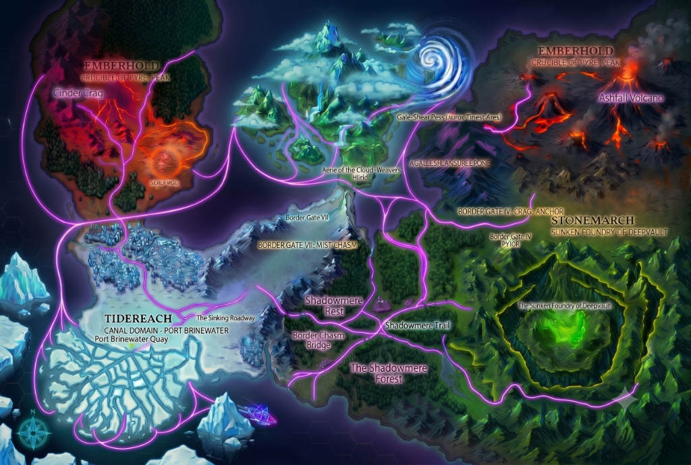
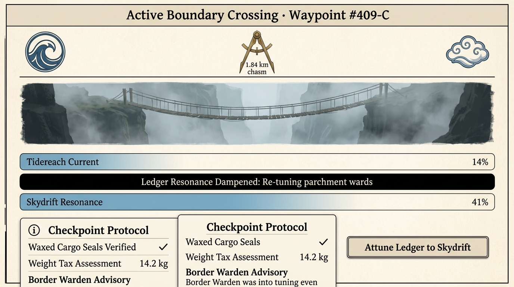
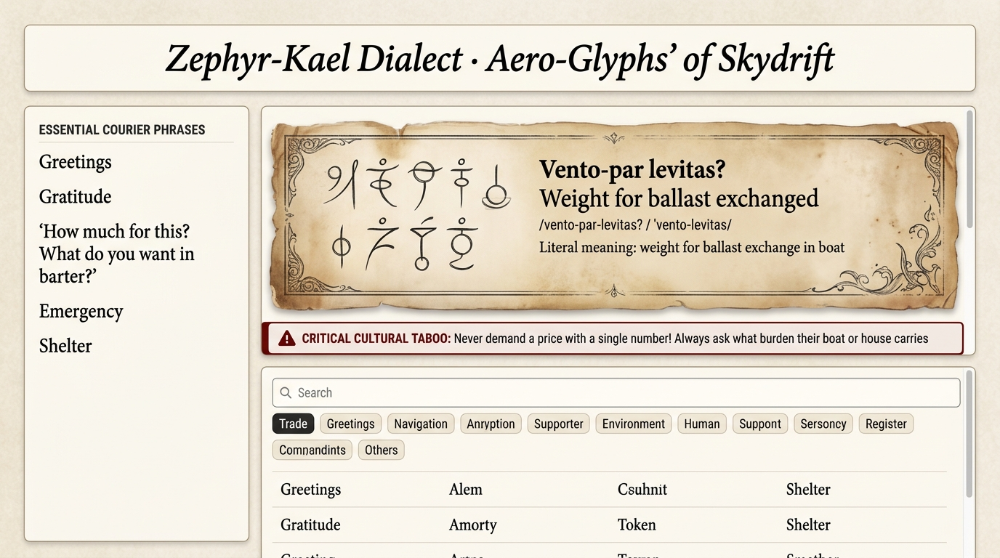
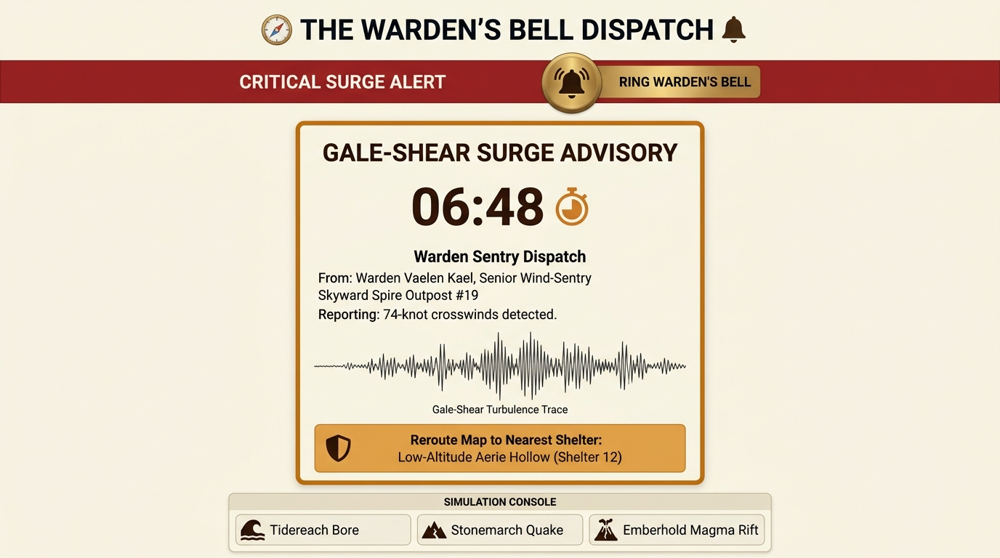

# The Wayfarer's Ledger — Orrin Courier Cartography & Barter Codex

> **Design Challenge Submission: "Build Your Own Universe"**  
> An in-universe tactile web application designed from the perspective of an apprentice courier in the elemental realms of Orrin.

---

## 🧭 The World of Orrin

Orrin is an ancient continent divided into four territorial Domains, each vitalized by a living elemental **Current**:

1. **Tidereach (Water Current · 32.4 ψ)**: A vast wetland realm of sunken marble palaces, winding reed canals, and floating market skiffs. Culture is fluid, indirect, and deeply hospitable. Stating prices outright is a cultural insult.
2. **Skydrift (Air Current · 41.0 ψ)**: Floating limestone archipelagos suspended above deep vapor abysses by perpetual updrafts. Couriers traverse cable sway-bridges and glide-skiffs. Culture is weight-conscious, nimble, and superstitious about ballast.
3. **Stonemarch (Earth Current · 18.6 ψ)**: Subterranean monolithic bastions and deep-vault shaft cities carved into granite bedrock. Culture is oath-bound, formal, and architectural. Broken promises result in civic exile.
4. **Emberhold (Heat Current · 68.2 ψ)**: Volcanic calderas and sulfur crucible towers. Culture is fiercely direct and honor-bound; hesitation is treated as deceit.

### The Four Fundamental World Rules
- **Rule 1 — Fading Signal & Territorial Attunement**: Currents are strongest at home capitals and fade toward frontiers. Because The Ledger is inscribed with resonant parchment wards, its interface dampens, flickers, and glitches near border crossings until re-attuned to the incoming domain frequency.
- **Rule 2 — Moneyless Scarcity Standard**: There is no universal currency. Value is strictly relative scarcity: each domain pays exorbitant rates for what its native Current cannot produce.
- **Rule 3 — Dialects & Invented Scripts**: Each Domain speaks its own dialect with its own writing system (angular pyre-runes, undulating wave-scripts, bedrock cuneiform, and aloft aero-glyphs). Strict cultural etiquette and taboo rules govern traveler speech.
- **Rule 4 — Current Surges & The Warden's Bell**: Currents occasionally experience violent turbulence (gale-shear winds, tidal bores, lithic tremors, magma blowouts). Attuned sentries called Wardens broadcast early warnings along physical meridian cables so travelers can divert to reinforced safe havens.

---

## 👤 The User Persona

- **Courier**: Ilan Dross (Age 19)
- **Role**: 1st-Degree Apprentice Courier, carrying official sealed cargo on his maiden voyage from **Port Brinewater (Tidereach)**, through the high suspension bridges of **Skydrift**, to the **Sunken Foundry of Deepvault (Stonemarch)**.
- **Payload**: Three waxed satchels (14.2 kg) secured with unbroken red beeswax seals.
- **Fears & Challenges**:
  - Being swindled by foreign merchants who use unfamiliar trade customs.
  - Committing a cultural taboo or offending locals in foreign territories.
  - Getting caught in an unpredicted atmospheric Current surge that could snap his cables or destroy his sealed cargo.

---

## 🛠️ The Problem & Solution

| The Challenge for Ilan | How The Wayfarer's Ledger Solves It |
|---|---|
| Inability to read or speak local dialects without committing taboos | **Tongue Shifter**: Real-time translations into authentic domain scripts (SVG glyphs), romanized phonetics, and urgent etiquette warnings against cultural insults. |
| Border transitions cause codex wards to fail | **Border Crossing (Waypoint VII)**: Dual-domain harmonic meters, cargo seal inspection dockets, and an attunement interface that smoothly re-themes the entire codex to the incoming domain. |
| Sudden elemental disasters on mountain and cloud paths | **Warden's Bell & Dynamic Rerouting**: Live countdown timer, Warden Vaelen's dispatch, barometric seismograph trace, and a single-click "Reroute" button that instantly recalculates Ilan's route on the living map. |

---

## 📸 Key Screen Gallery

### 1. Living Map View
*Hand-built interactive SVG cartography of Orrin showing the four elemental territories, living current density gradient overlays, hazard zones, Ilan's glowing courier route, and the interactive Waypoint Docket.*


### 2. Border Crossing (Gate VII: The Mist Chasm Bridge)
*Boundary demarcation docket featuring dual sigils, 1.84 km chasm vignette, cargo seal verification, weight tax assessment, dampened ledger resonance ribbons, and interactive attunement trigger.*


### 3. Tongue Shifter & Script Codex
*Procedural custom SVG script renderer (wave-script, aero-glyphs, cuneiform, pyre-runes), romanized phonetics, literal meanings, critical taboo warnings, and searchable domain lexicon.*


### 4. Warden's Bell (Surge Early-Warning System)
*Urgent light-theme disaster alert for a Gale-Shear Surge in Skydrift, featuring a live countdown timer, Warden Vaelen's dispatch, seismograph trace, and an interactive "Reroute to Nearest Shelter" button.*


---

## 🎨 In-Universe Aesthetic & Design System

The application strictly adheres to the prompt's design guidelines:
- **Light Theme Only**: Warm parchment creams (`#f9f6ed`, `#fdf9f0`), aged brass, and deep ink typography (`#0a1f2c`, `#1f1b16`) ensuring WCAG AA contrast.
- **Tactile Physical Codex**: Subtle deckled edges, parchment grain stippling, braided rope-and-knot dividers, and wax seal badges.
- **Reactive Current Interference**: When near frontiers (current strength < 35%), the codex experiences procedural signal dampening and faint flicker animations (`fading-current-static`).
- **Domain Re-Theming**: CSS variables on `data-domain` dynamically update border radii, accent harmonics, and shadow depths per domain:
  - *Tidereach*: Gentle wave curves (radius: 0.85rem), oceanic teal and brass accents.
  - *Skydrift*: Airy floating cards (radius: 0.65rem), soft azure updraft tones, spacious whitespace.
  - *Stonemarch*: Heavy blocky cards (radius: 0.25rem), sandstone, deep basalt ink, carved borders.
  - *Emberhold*: Sharp chamfered edges (radius: 0.35rem), thermal cinder and forged gold tones.
- **Framed Map & Dynamic Elemental Side Pane**:
  - The map does not occupy the full screen; it sits in a framed tactical explorer canvas alongside a rich, dedicated Side Pane.
  - As you hover through the map, the side pane dynamically updates in real time to describe that exact place, including environmental metrics, lore, sensory quotes, customs, and taboos.
  - **The UI of the side pane dynamically shifts its visual theme depending on the territory**:
    - **Emberhold**: *Fire themed* with smoldering charcoal, molten lava gradients, rising animated ember sparks, and crucible thermal meters.
    - **Tidereach**: *Underwater themed* with abyssal ocean blues, bioluminescent cyan, rising water bubble animations, and fathom depth gauges.
    - **Stonemarch**: *Earth and Nature themed* with ancient moss emeralds, granite slate, bedrock tectonic resonance, and keystone load indicators.
    - **Cloud Weavers Region (Skydrift)**: *Air themed* with aloft sky azure, drifting cloud mist animations, and atmospheric updraft knot velocities.
  - **Danger-Only Pop-up Rule**: Pop-up alerts appear **only** when moving through dangerous zones (Gale-Shear Pass vortex, Sulfur Vents, Ashfall Volcano molten caldera); otherwise, all location descriptions and dockets remain unobtrusively inside the side pane.
  - **Strict Violet Path Tracking**: Navigator icon glides exclusively along the neon violet path network when moving the cursor.
- **Dark Mode & Universal Capsule Design**: Sleek dark aesthetic with capsule-shaped containers (`rounded-full`, `rounded-3xl`, `rounded-[2rem]`) across all cards, badges, and buttons.
- **Zero Stock Icon Packs**: Custom SVG elemental Current sigils, diamond gateway portals for border gates, Warden eye seals, and braided courier knots.
- **Zero-Dependency Procedural Audio**: Web Audio API synthesizes realistic brass bells, resonant attunement sweeps, and wooden clicks.

---

## 🚀 Getting Started

### Prerequisites
- Node.js (v18+ recommended)
- npm

### Installation & Local Run
```bash
# 1. Install dependencies
npm install

# 2. Start the Vite local development server
npm run dev

# 3. Open in your browser
http://127.0.0.1:5173/
```

### Production Build & Typecheck
```bash
npm run build
```

---

## 📁 Clean Component Architecture

```
src/
├── types/
│   └── world.ts                 # Type definitions for Domains, Waypoints, Languages, Alerts
├── data/
│   ├── domains.ts               # Lore, elemental attributes, and scarcity profiles for 4 realms
│   ├── route.ts                 # Ilan Dross journey waypoints, coordinates, and hazards
│   ├── languages.ts             # Invented vocabularies (30+ words each), phrases, and taboos
│   └── wardenSurges.ts          # Active Gale-Shear alert, All-Clear state, and multi-domain surges
├── context/
│   └── LedgerContext.tsx        # Global state, procedural Web Audio, domain re-theming, journey stepper
├── components/
│   ├── Header.tsx               # Ilan Dross avatar, current harmonic meter, domain switcher, sound toggle
│   ├── Navigation.tsx           # 3 core tabs (Living Map, Tongue Shifter, Warden's Bell)
│   ├── MapView.tsx              # Hand-built SVG map, glowing route, current overlays, waypoint docket
│   ├── BorderCrossing.tsx       # Mist Chasm Bridge modal, cargo seals, and attunement animation
│   ├── TongueShifter.tsx        # Custom SVG script renderer, courier phrases, taboo warnings, lexicon
│   ├── WardensBell.tsx          # Real-time disaster alert, countdown, seismograph, and map rerouting
│   ├── JourneyControls.tsx      # Bottom-docked courier stepper ("Prev Leg", "Next Leg", Waypoint dots)
│   ├── AboutWorldModal.tsx      # Deep lore codex explaining Orrin's rules and design rationale
│   ├── ScriptGlyphRenderer.tsx  # Procedural SVG script rune generator for 4 invented writing systems
│   └── OrrinIcons.tsx           # Bespoke SVG CurrentSigil, WardenSigil, RopeKnotDivider, WaxSealBadge
├── App.tsx                      # Root application assembly with parchment textures and modal routing
├── index.css                    # Tailwind CSS v4 setup, domain CSS variable tokens, and grain effects
└── main.tsx                     # React 19 application entry point
```

---

## 🚶 Primary User Flow Demo

1. **Embark at Port Brinewater**: Open the *Living Map*. Examine Ilan's starting berthing in Tidereach with 96% Water Current intensity.
2. **Advance the Journey**: Click **"Next Leg"** in the bottom journey controller to move to *The Sinking Reedway*, then click **"Next Leg"** again to reach *Border Gate VII: The Mist Chasm Bridge*.
3. **Cross the Frontier & Attune**: The *Border Crossing* modal automatically engages. Review the unbroken cargo seals and 1.84 km chasm bridge. Click **"Attune Ledger to Skydrift"** to observe the harmonic meter climb to 100%, trigger festive attunement particles, and watch the entire application re-theme its styling to Skydrift!
4. **Translate with Etiquette Compliance**: Open the **Tongue Shifter** tab. Select *"How much for this?"* and observe how the codex displays an urgent **Critical Taboo Warning** (demanding a flat price in Tidereach or Skydrift insults hospitality; one must ask what burden their boat carries).
5. **Respond to the Warden's Bell**: Switch to **Warden's Bell**. Notice the active **CRITICAL GALE-SHEAR SURGE** warning with the countdown timer ticking down. Click **"Reroute Map to Nearest Shelter"**—a brass warning chime sounds, and navigating back to the *Living Map* shows the route safely diverted to *Low-Altitude Aerie Hollow (Shelter 12)*!
